# Odor Prediction: SMILES and Code Guide

This project uses the notebook [odor_prediction.ipynb](./odor_prediction.ipynb) to predict odor-descriptor labels from molecular structures. It compares two models built on Morgan fingerprints (Logistic Regression and Random Forest) with a graph neural network (GNN), using data from the Pyrfume Leffingwell and GoodScents collections.

## Summary of findings

- Under both random and scaffold splits, **Logistic Regression and the GNN perform equivalently**: their mean difference is much smaller than the variation across seeds. This README does not claim a winner between them.
- **Random Forest is the weakest model** in both settings (about 0.012 macro AUROC below LR/GNN on random splits; about 0.027 below LR on scaffold splits, a gap of roughly one standard deviation).
- Scaffold splits are harder than random splits for every model (about 0.04 lower macro AUROC), as expected when whole molecular frameworks are held out.

Details, and a paired per-seed comparison of the GNN against LR, are in [Model comparison](#model-comparison).

## What is SMILES?

**SMILES** (Simplified Molecular Input Line Entry System) is a text notation for describing a molecule's atoms and the bonds between them. Instead of storing a molecule as a drawing, SMILES records a path through its structure, with symbols for branches, bond types, and rings.

| SMILES | Structure described |
| --- | --- |
| `C` | Methane |
| `CC` | Ethane: two carbon atoms joined by a single bond |
| `CCO` | Ethanol |
| `CC(=O)O` | Acetic acid; parentheses mark a branch and `=` marks a double bond |
| `c1ccccc1` | Benzene; lowercase `c` denotes aromatic carbon and `1` closes the ring |

Common notation:

- Element symbols such as `C`, `N`, and `O` represent atoms. Lowercase forms such as `c` and `n` represent aromatic atoms.
- Writing atoms next to each other implies a single bond unless another bond symbol is given. `=`, `#`, and `-` indicate double, triple, and explicit single bonds.
- Parentheses indicate a branch from the current atom, as in `CC(=O)O`.
- Matching digits mark the two ends of a ring closure, as in the `1` digits in `c1ccccc1`.
- A dot (`.`) separates disconnected components, such as the parts of a salt.
- SMILES can encode stereochemistry as well as connectivity. This notebook deliberately removes stereochemistry during canonicalization, so stereoisomers with the same connectivity are treated as the same molecule.

SMILES is a representation, not an odor description: the notebook uses it to reconstruct molecular structures and derive input features for its models.

## What the notebook does

The notebook is designed to be run from top to bottom. Its main stages are:

1. **Configure and prepare.** Set the data source, split strategy, random seed, label-frequency cutoff, and GNN hyperparameters. Check for required Python packages, clone `pyrfume-data` if the expected local data folder is missing, and create `results/`, `models/`, and `figures/`.
2. **Load and standardize data.** Read the selected odor dataset and associate each observation with a SMILES string. GoodScents descriptor text is split into individual labels. RDKit parses and canonicalizes each structure; invalid or missing structures are discarded.
3. **Build the prediction targets.** Rows with the same canonical SMILES are merged, combining their labels with a maximum (so a positive label from either row remains positive). Labels with fewer than `MIN_POS` positive molecules are removed, as are molecules left with no retained labels. The resulting target matrix has one row per molecule and one binary column per odor label.
4. **Create data splits and inspect the data.** A seeded random split or a Murcko-scaffold split creates training, validation, and test sets. The exploratory analysis plots label frequencies and co-occurrences, label counts per molecule, molecular properties, and scaffold group sizes.
5. **Evaluate fingerprint baselines.** RDKit computes radius-2, 2048-bit Morgan **count** fingerprints. A multi-output Random Forest and one Logistic Regression classifier per label use these features. Their test-set predictions are evaluated with per-label and macro AUROC.
6. **Train the graph neural network.** Each molecule becomes a graph: atoms are nodes, bonds are undirected edges, and atom features describe element, degree, hydrogen count, hybridization, aromaticity, ring membership, and formal charge. A GIN (Graph Isomorphism Network) updates atom representations, pools them into one molecule vector using sum and mean pooling, and predicts all labels. Training uses weighted binary cross-entropy and selects the checkpoint with the best validation macro AUROC, with early stopping.
7. **Compare results and visualize embeddings.** Per-label results from available runs are aggregated and written to CSV; when both GNN and Random Forest results exist, a scatter plot compares their per-label AUROCs. The extras section calculates GNN embeddings and plots a UMAP projection colored by selected odor labels.

### A few implementation details

- **Canonicalization matters.** `_flat_canonical` parses each SMILES with RDKit, removes stereochemistry, then writes a canonical SMILES. This helps group different text spellings of the same connectivity together, but it intentionally collapses stereoisomers. It does not mean that different disconnected components are removed.
- **Stereochemistry is a scientific limitation, not only a technical choice.** Stereoisomers can smell different (carvone is a well-known example), so collapsing them removes information that may matter for odor.
- **Random vs. scaffold split.** A random split can put closely related structures in both training and test sets. The scaffold split groups molecules by their Murcko ring/framework scaffold before assigning groups to partitions, providing a stricter test of generalization to different frameworks. Acyclic molecules are assigned separate groups.
- **AUROC.** Per-label AUROC measures how well a model ranks positive examples above negative examples, across thresholds. Macro AUROC averages the per-label scores; labels without both classes in a particular evaluation split have undefined AUROC and are skipped by the average.
- **The GNN's atom representation is intentionally compact.** The current graph construction uses atom features and bond connectivity; it does not add explicit bond-type features.
- **Interpretability helpers.** The notebook defines an atom-level gradient-times-input contribution function and lists example functional groups, but the current notebook cells do not apply that function to molecules or produce saliency figures. The label-geometry check is also described in the extras heading but is not implemented in the current cells.
- **Predictions are learned associations.** A predicted descriptor is a model estimate from the dataset, not a guarantee of how every person will perceive a molecule and not evidence that a specific atom causes an odor.

## Model comparison

All results use the Leffingwell dataset. Each setting was run with seeds 0-10 (11 seeds). For each run, macro AUROC is the average of the defined per-label test AUROCs; tables report the mean and population standard deviation across seeds. The standard deviations describe variation across seeds and are not confidence intervals.

### Random split results

Macro AUROC is averaged across 84 odor labels with defined scores.

| Model | Input features | Test macro AUROC (mean ± SD) |
| --- | --- | ---: |
| Logistic Regression (LR) | Morgan count fingerprints | 0.8799 ± 0.0053 |
| Random Forest (RF) | Morgan count fingerprints | 0.8678 ± 0.0062 |
| Graph Neural Network (GNN) | Molecular graph | 0.8806 ± 0.0075 |

The GNN and LR means differ by 0.0007, far less than the standard deviation across seeds (0.005-0.008), so the two are treated as tied. RF is lower than both by about 0.012.

### Scaffold split results

Murcko-scaffold splits. The number of labels included per run ranges from 82 to 84, because labels without both classes in a test set have undefined AUROC and are skipped.

| Model | Input features | Test macro AUROC (mean ± SD) |
| --- | --- | ---: |
| Logistic Regression (LR) | Morgan count fingerprints | 0.8416 ± 0.0227 |
| Random Forest (RF) | Morgan count fingerprints | 0.8143 ± 0.0258 |
| Graph Neural Network (GNN) | Molecular graph | 0.8373 ± 0.0392 |

The LR and GNN means differ by 0.0043, much less than their standard deviations (0.023 and 0.039), so they are again treated as tied. RF has the lowest mean, but its gap to LR (about 0.027) is only about one standard deviation. Scaffold splits hold out molecular frameworks and give a more demanding measure of generalization to structurally distinct molecules. Aggregate per-label scores are saved in `results/per_label_<SOURCE>_scaffold.csv`.

### Paired comparison: GNN vs. LR

Comparing two means with their separate standard deviations ignores the fact that, within a seed, both models are evaluated on the same split. A paired comparison removes the variation caused by the split itself, so it is more sensitive to a real difference.

**Method.** For each seed `s`, compute

```
d_s = macro_AUROC_GNN(s) - macro_AUROC_LR(s)
```

then report, over the 11 seeds:

- the mean and standard deviation of `d_s`,
- the number of seeds in which the GNN beats LR (`d_s > 0`),
- the p-value of a two-sided Wilcoxon signed-rank test on the `d_s` values (`scipy.stats.wilcoxon`).

Interpretation: if `d_s` fluctuates around zero and the p-value is not small, there is no evidence of a difference. With 11 seeds the smallest possible two-sided Wilcoxon p-value is about 0.001, so the test has limited resolution. The seeds are repeated runs on one dataset, not independent samples of molecules, so the p-value should be read as indicative rather than as a formal guarantee.

**Results.** *To be filled in from the saved per-seed results in `results/`.*

| Split | Mean `d_s` (GNN − LR) | SD of `d_s` | Seeds with GNN > LR | Wilcoxon p (two-sided) |
| --- | ---: | ---: | ---: | ---: |
| Random | TBD | TBD | TBD / 11 | TBD |
| Scaffold | TBD | TBD | TBD / 11 | TBD |

## Figures

The following figures are included in [`figures/`](./figures/):

| Exploratory analysis | Figure |
| --- | --- |
| Odor label frequency | 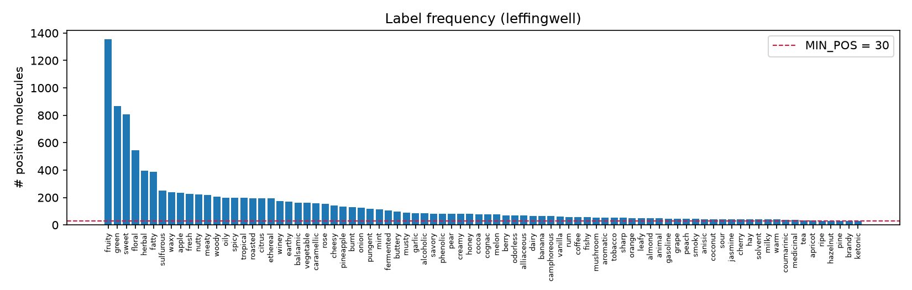 |
| Odor label co-occurrence | 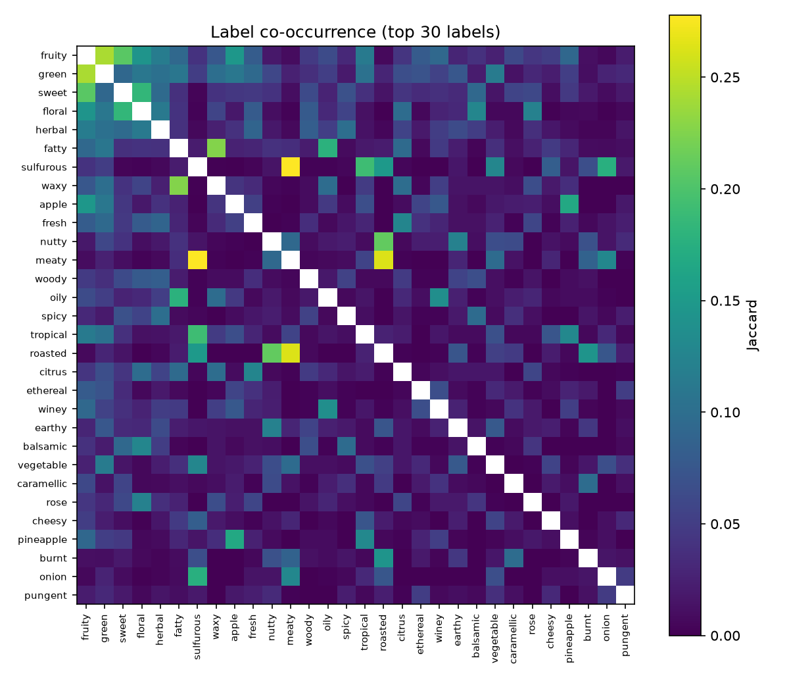 |
| Number of labels per molecule | 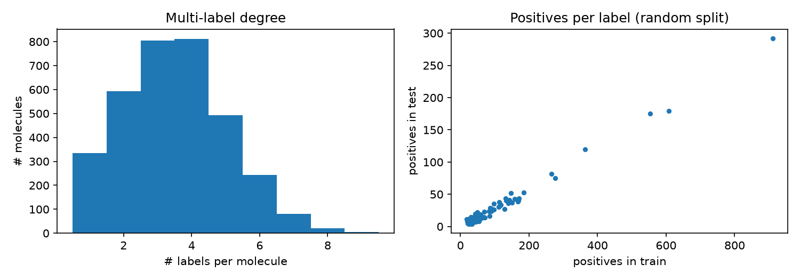 |
| Molecular properties | 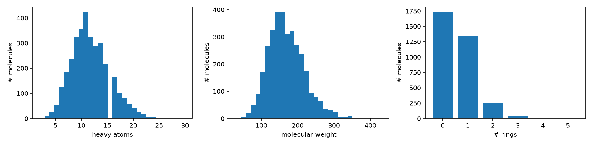 |
| Per-label model comparison | 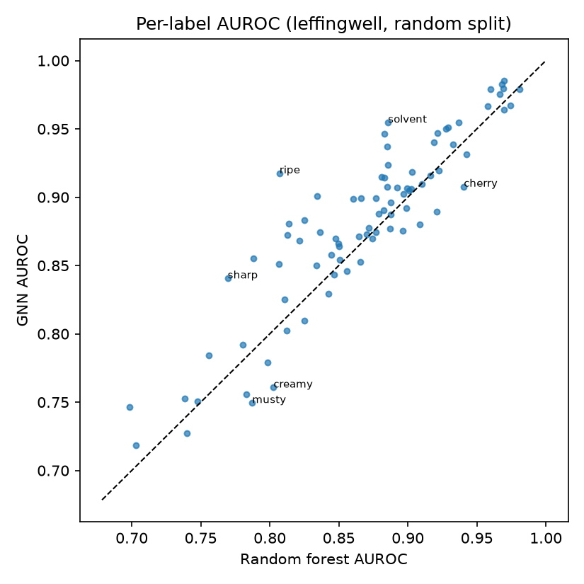 |
| Scaffold-split labels per molecule | 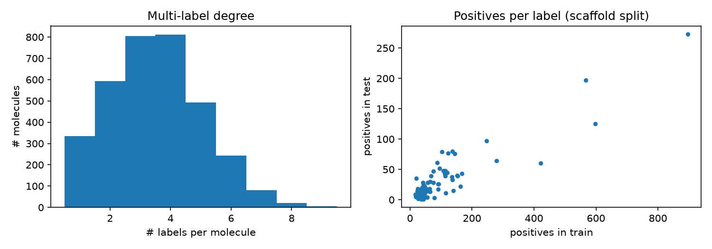 |
| Scaffold-split model comparison | 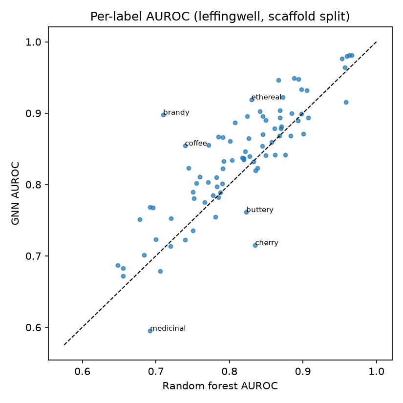 |

### GNN embedding projections by seed

Each image shows a UMAP projection of GNN embeddings for that run, colored by odor labels. The layouts are computed independently for each seed and are not directly aligned across images.

| Seed | Random split | Scaffold split |
| ---: | --- | --- |
| 0 | 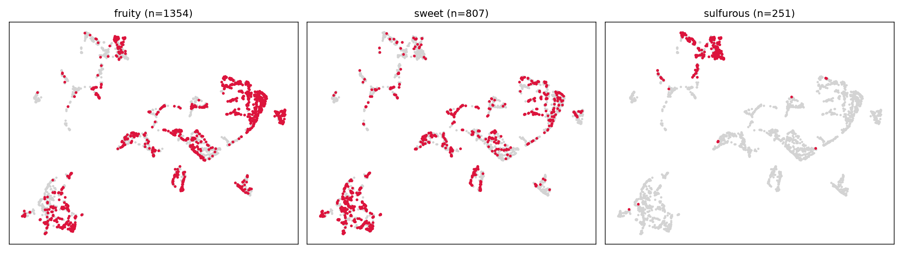 | 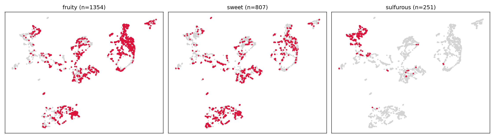 |
| 1 | 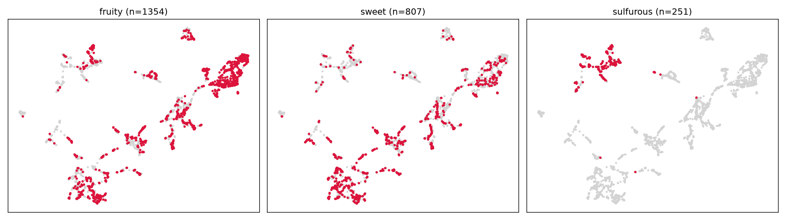 | 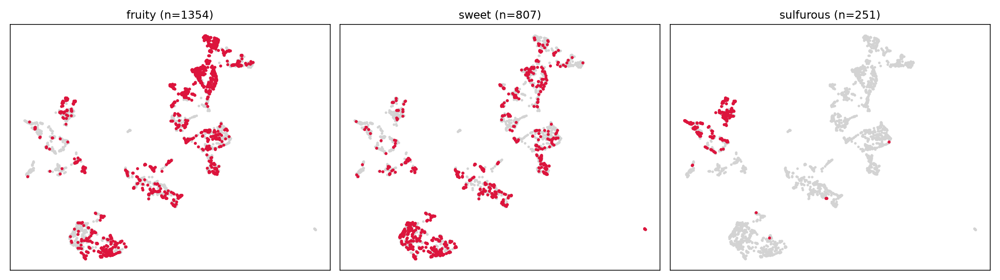 |
| 2 | 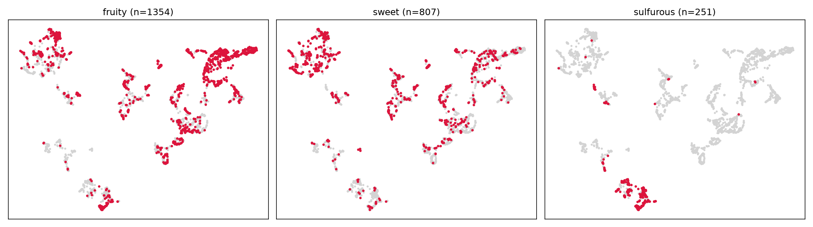 | 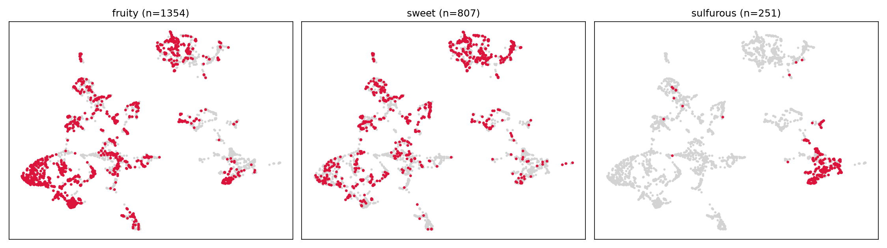 |
| 3 | 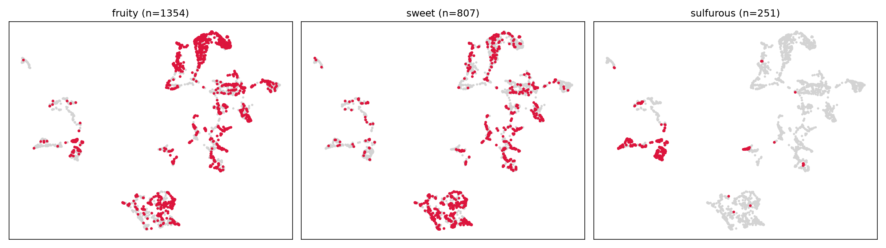 | 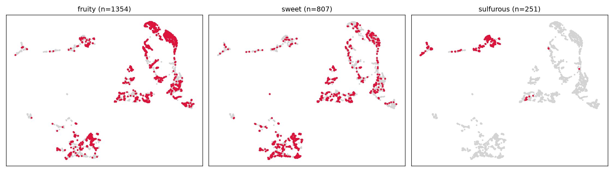 |
| 4 | 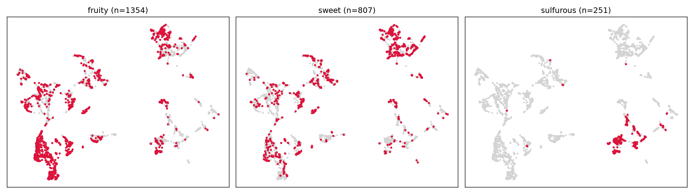 | 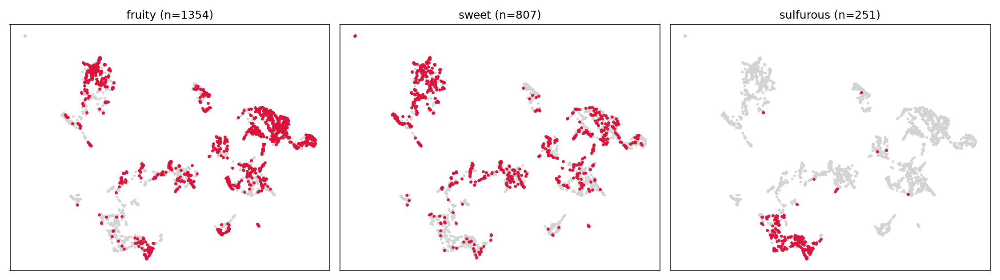 |
| 5 | 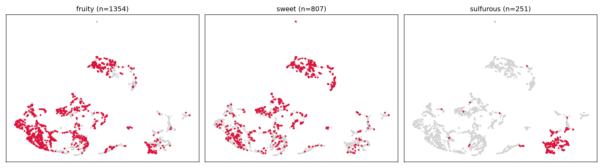 | 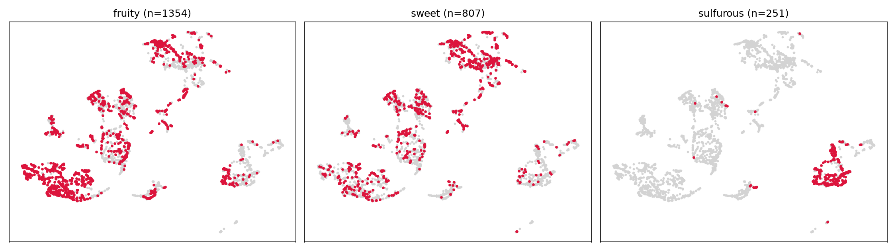 |
| 6 | 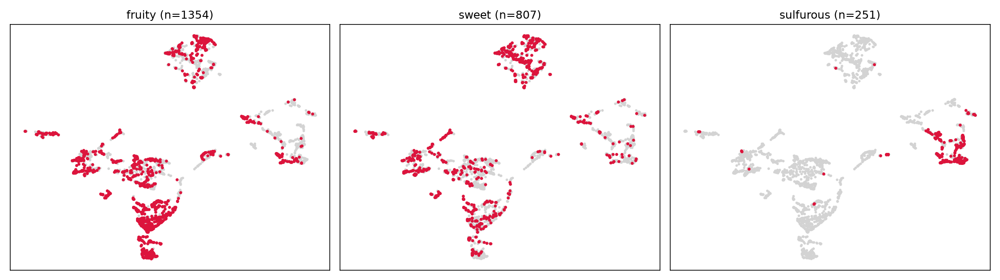 | 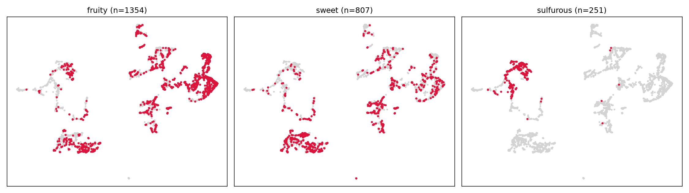 |
| 7 | 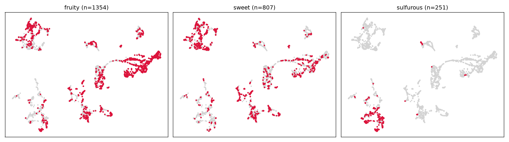 | 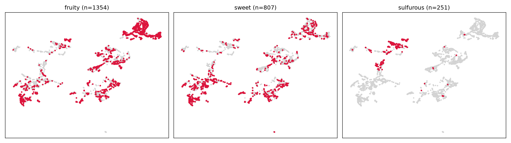 |
| 8 | 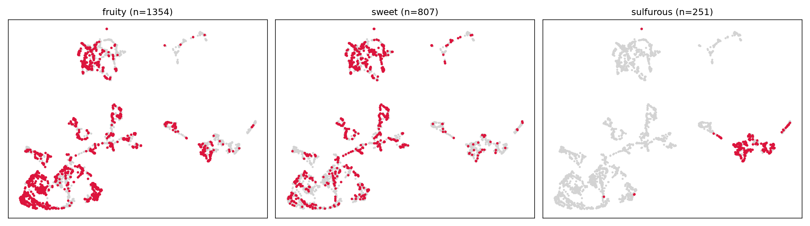 | 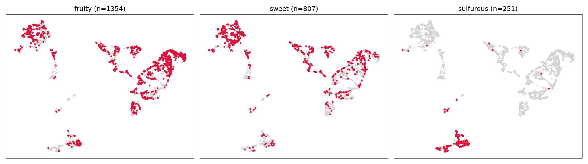 |
| 9 | 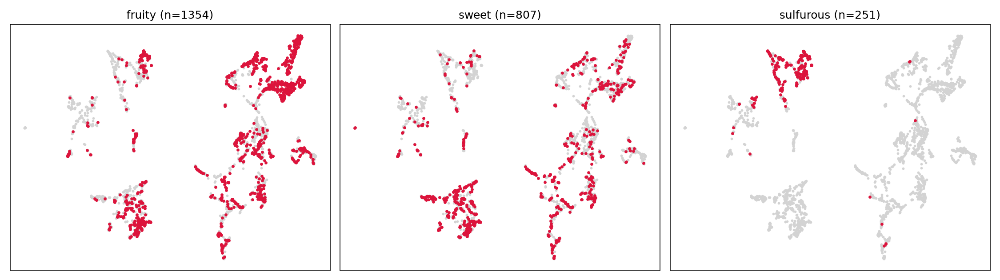 | 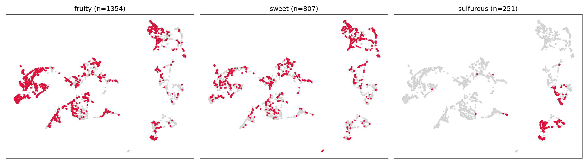 |
| 10 | 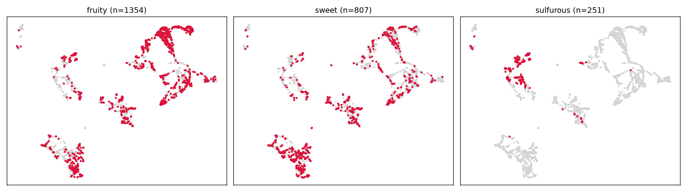 | 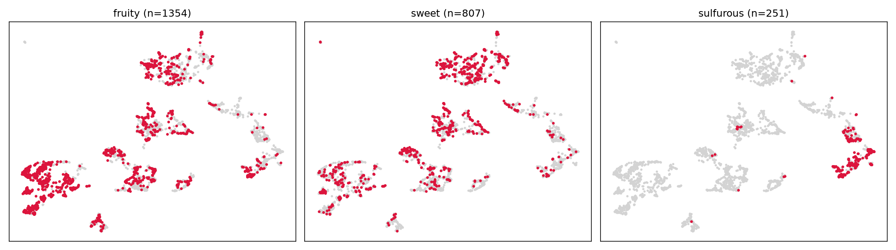 |

## Running it

### Set up an environment

Create a dedicated environment rather than using the conda `base` environment:

```bash
conda create -n odor-project python=3.11
conda activate odor-project
conda install -c conda-forge rdkit numpy pandas scikit-learn matplotlib umap-learn jupyter
```

Then install PyTorch and PyTorch Geometric following the official instructions for your operating system and hardware (CPU-only or a specific CUDA version).

### Run the notebook

Open the notebook in Jupyter (or VS Code, selecting the `odor-project` kernel) and run its cells in order:

```bash
jupyter notebook odor_prediction.ipynb
```

The notebook checks for these main dependencies: NumPy, pandas, RDKit, scikit-learn, PyTorch, PyTorch Geometric, Matplotlib, and UMAP.

At the top of the notebook, the main settings are:

- `SOURCE`: `"leffingwell"`, `"goodscents"`, or `"merged"`.
- `SPLIT`: `"random"` or `"scaffold"`.
- `SEED`: random seed for reproducibility and for naming saved outputs.
- `MIN_POS`: minimum number of positive molecules required to retain a label.
- `EPOCHS`, `PATIENCE`, `HIDDEN`, `LAYERS`, `DROPOUT`, `LR`, and `BATCH_SIZE`: GNN training settings.
- `DATA_DIR`: location of the Pyrfume data repository.

### Running many seeds without editing the notebook

[papermill](https://papermill.readthedocs.io/) can execute the notebook repeatedly with different parameters. Tag the configuration cell with `parameters`, then:

```bash
pip install papermill
mkdir -p runs
for split in random scaffold; do
  for s in $(seq 0 10); do
    papermill odor_prediction.ipynb runs/${split}_seed${s}.ipynb -p SPLIT $split -p SEED $s
  done
done
```

Output CSVs, checkpoints, and figures are named by source, split, and seed, so runs do not overwrite each other. Add `runs/` to `.gitignore`.

### Pyrfume data as a Git submodule

The `pyrfume-data/` directory is a separate Git repository, so this project links to it as a submodule instead of copying its data files into the main repository. The main repository records the submodule URL and the specific data-repository commit it uses; it does not store another copy of the data.

To clone this project and fetch the linked data repository in one step:

```bash
git clone --recurse-submodules https://github.com/phatchill/odor-project.git
```

If you already cloned the project without its submodule, initialize it from the project directory:

```bash
git submodule update --init --recursive
```

When adding the submodule to the main project for the first time, run this from the project root, using the data-repository URL you intend to use:

```bash
git submodule add https://github.com/pyrfume/pyrfume-data.git pyrfume-data
```

Replace the URL with your own fork if appropriate. The target `pyrfume-data/` path must not already contain a separate checkout when adding it this way. Once added, commit both `.gitmodules` and the submodule reference in the main repository. Check the upstream repository's license and any dataset-specific terms before redistributing its data.

The notebook saves per-model AUROC CSVs and aggregate results in `results/`, the trained GNN checkpoint in `models/`, and exploratory/model-comparison plots in `figures/`. File names include the data source, split, and seed. Use the validation set for model selection and reserve the test set for final evaluation.